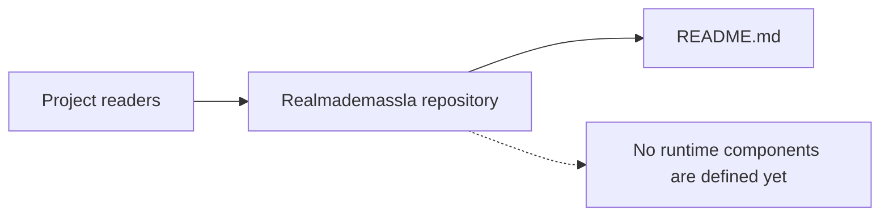

# Architecture Overview

The repository currently contains only `README.md`; no application code, services, data stores, or deployment configuration are present. This diagram therefore describes the repository's current structure, not a runtime application architecture.

